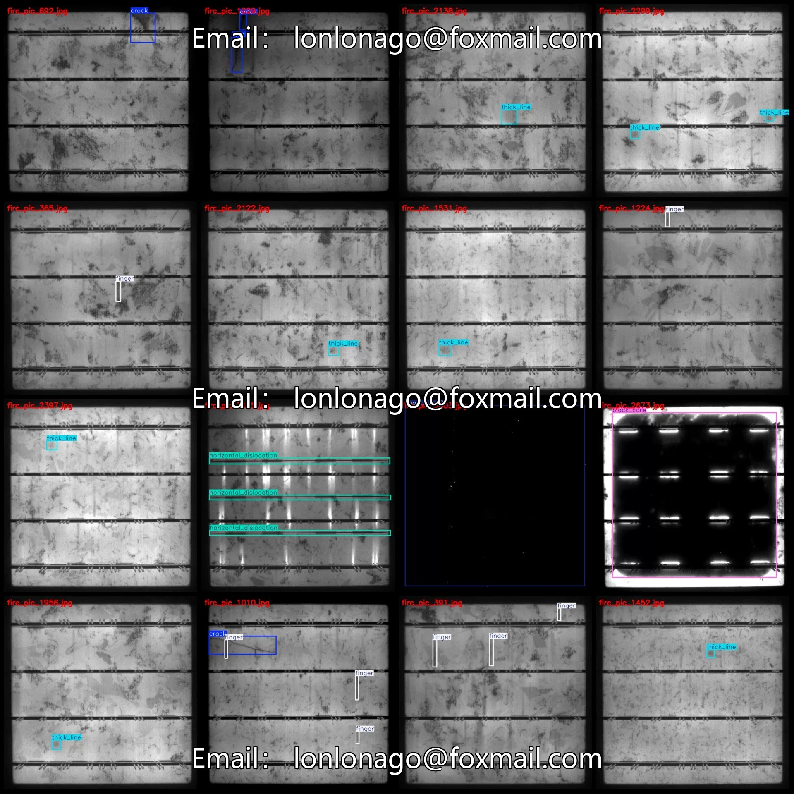
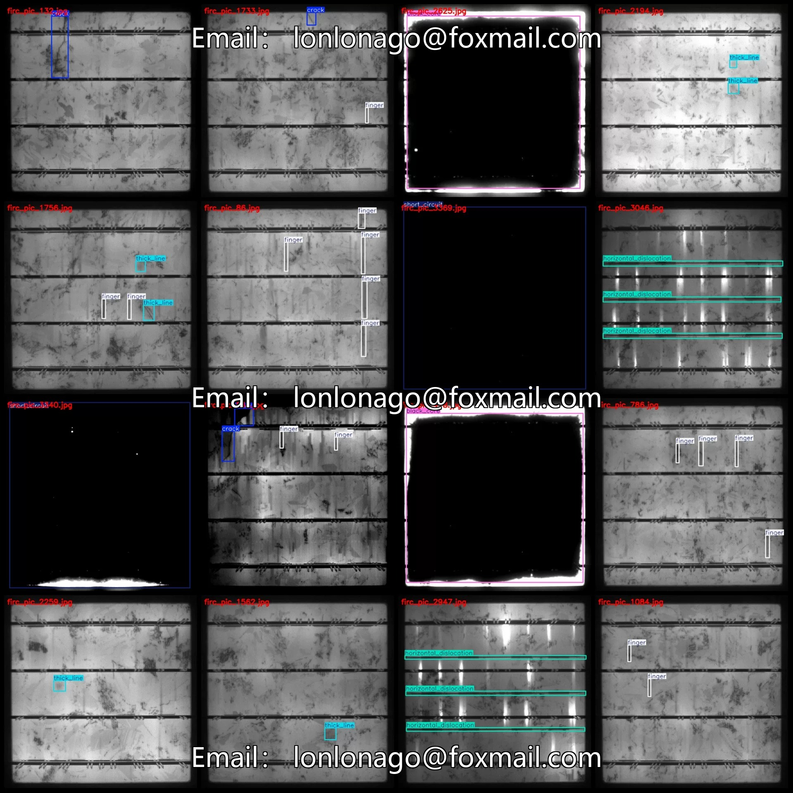
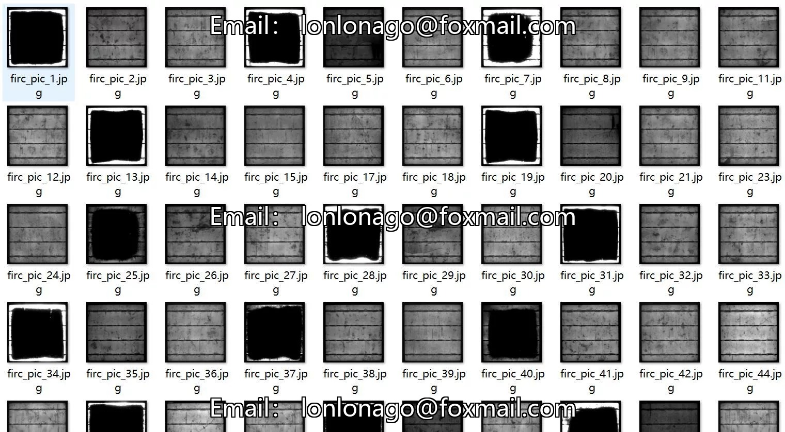
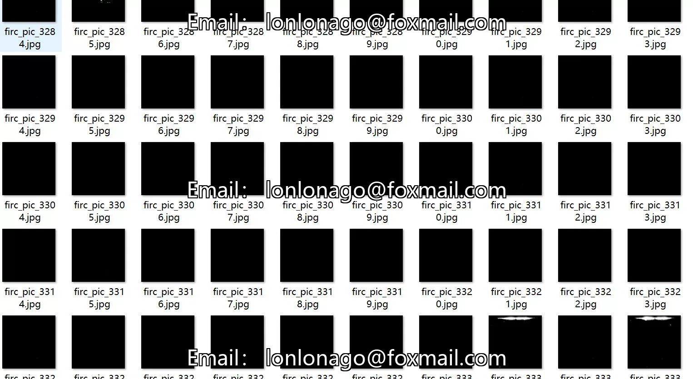
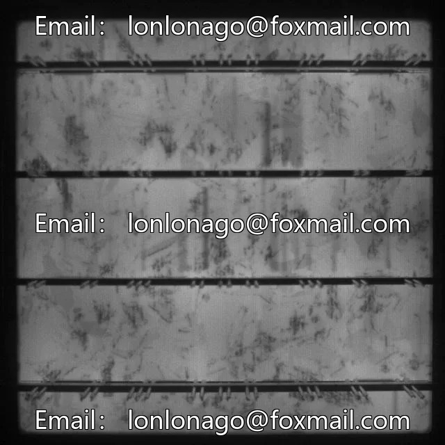
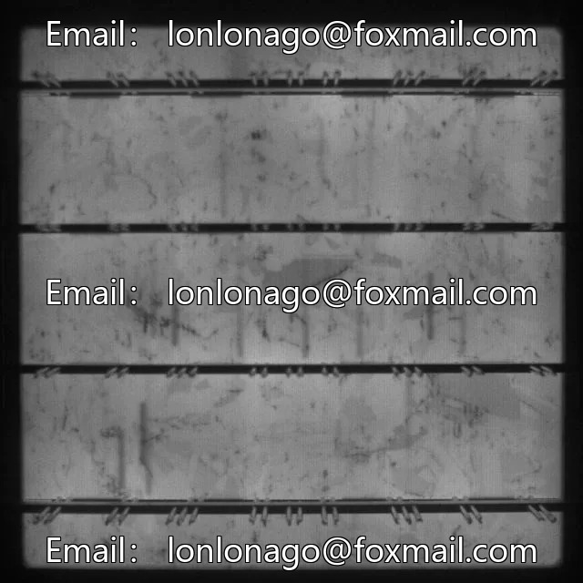
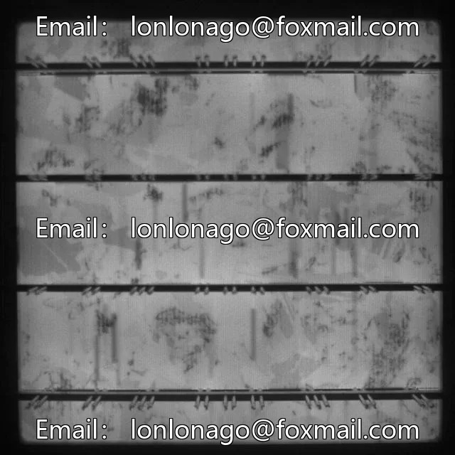

# Near-infrared image solar panel defect dataset VOC+YOLO format 3644

## Body

Near-Infrared Image Solar Panel Defects Dataset - VOC+YOLO Format: 3644 Images in 12 Categories
Warm Reminder: Due to the dataset's replicability, please confirm compliance with requirements before purchasing.
Dataset Format: Pascal VOC format + YOLO format (txt file without split path, only containing jpg images and corresponding VOC format xml files and yolo format txt files)
Number of Images (Total jpg files): 3644
Number of Annotations (Total xml files): 3644
Number of Annotations (Total txt files): 3644
Number of Annotation Categories: 12

Annotation Category Names: ["black_core", "corner", "crack", "finger", "fragment", "horizontal_dislocation", "printing_error", "scratch", "short_circuit", "star_crack", "thick_line", "vertical_dislocation"]
Number of boxes and image counts per category:

black_core (Black Core) Frame Count = 777, Image Count = 761
corner (defective corner/cracked corner) frame count = 7, occupied picture count = 6
Crack (cracks) Frames = 1210, Pictures = 924
Fingerprint (fingerprint) frame count = 1820, fingerprint count = 948
Fragment (fragment) count = 7, occupied by image count = 7
Horizontal Dislocation (horizontal dislocation) Frames = 798, Pictures occupied = 266

Printing error (printing error) box number = 32, occupying image count = 2
Scratch (scratch) frame count = 5, occupying image count = 3
Short-circuit (short circuit) frame count = 448, occupying picture count = 448
star_crack (Star Crack) Frames = 133, Pictures = 121
Thick_line (thick line) frame count = 948, occupying image count = 750
Vertical dislocation (vertical misalignment) frame count = 137, occupying image count = 34
Total frame count: 6322

Image resolution: 640x640
Using labeling tool: labelImg
Labeling rules: Draw a rectangle around the category.
Important note: The dataset does not have separate training, validation, and test sets; you need to partition them yourself.
Special declaration: This dataset does not guarantee the accuracy of the trained models or weight files.

## Images

## Payment

Here is a pay link on Stripe ( https://buy.stripe.com/3cs8yP7sY87d0vu9AB ). Please contact me lonlonago@foxmail.com after funding $89, and I will send you a complete data files , thank you!

